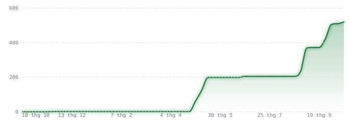

<!-- Profile README for akari310 -->

# Nguyễn Ngọc Anh 

**Full Stack Developer · Competitive Programmer**

[Email](https://mail.google.com/mail/?view=cm&fs=1&to=ngocanhyb2009@gmail.com) ·
[GitHub](https://github.com/akari310) ·
[VNOI](https://oj.vnoi.info/user/akari310) ·
[YouTube Ultimate Tools](https://github.com/akari310/youtube-tools)

---

## 📊 Stats

<picture>
  <source media="(prefers-color-scheme: dark)" srcset="https://github-readme-stats.vercel.app/api?username=akari310&show_icons=true&hide_border=true&bg_color=0d1117&ring_color=3fb950&text_color=e6edf3&title_color=3fb950&line_color=3fb950&icon_color=3fb950">
  <source media="(prefers-color-scheme: light)" srcset="https://github-readme-stats.vercel.app/api?username=akari310&show_icons=true&hide_border=true&bg_color=ffffff&ring_color=1a7f37&text_color=1f2328&title_color=1a7f37&line_color=1a7f37&icon_color=1a7f37">
  
</picture>

<picture>
  <source media="(prefers-color-scheme: dark)" srcset="https://github-readme-stats.vercel.app/api/top-langs/?username=akari310&layout=compact&hide_border=true&bg_color=0d1117&ring_color=3fb950&text_color=e6edf3&title_color=3fb950&line_color=3fb950">
  <source media="(prefers-color-scheme: light)" srcset="https://github-readme-stats.vercel.app/api/top-langs/?username=akari310&layout=compact&hide_border=true&bg_color=ffffff&ring_color=1a7f37&text_color=1f2328&title_color=1a7f37&line_color=1a7f37">
  
</picture>

<picture>
  <source media="(prefers-color-scheme: dark)" srcset="assets/activity-dark.svg">
  <source media="(prefers-color-scheme: light)" srcset="assets/activity-light.svg">
  
</picture>

Lao Cai, Vietnam · 5 public repositories · joined GitHub 2 years ago 
Contributions climbing week by week — 520 in the last year, in three bursts.

---

## 👋 About

Full stack developer and competitive programmer based in Lao Cai, Vietnam. I care about code
that reads clearly, interfaces that stay elegant, and problems worth solving.

- Regular participant in online judges and hackathons
- Ship things end to end — front end, back end, and the pipeline behind them
- Anime and art in my spare time

**Fun fact:** anime and music is the reward after a long coding session.

---

## 🛠️ Stack

**Frontend** — HTML5 · CSS3 · JavaScript · TypeScript · React · Next.js  
**Backend** — C++ · Node.js · Express · Python  
**Database** — MongoDB · PostgreSQL  
**Tooling** — Docker · Git · GitHub Actions · Jest · Cypress

Advanced in React, HTML/CSS/JavaScript and Python/C++ · Intermediate in Next.js/TypeScript and Node.js/Express

---

## 📌 Projects

| | |
|---|---|
| **[YouTube Ultimate Tools](https://github.com/akari310/youtube-tools)** | Userscript for YouTube and YouTube Music — downloads with in-browser tagging, WebGL Ambilight, comment translation, 20+ toggles. GPL-3.0 |
| **[All repositories](https://github.com/akari310?tab=repositories)** | Web apps, competitive programming solutions, and more |

---

## 🖼️ Gallery

Shiraori, the spider goddess — my taste in creative problem solving.

  
  

---

## ❓ FAQ

**Can I use your code?**
Check the license in the repo — they differ. Give credit if you reuse the work.

**How can I contact you?**
Email is best: [ngocanhyb2009@gmail.com](mailto:ngocanhyb2009@gmail.com)

**What inspires your projects?**
Creative problem solving, clean design, and the challenge of building something new.

**What are your favorite tools?**
Sublime Text, VSCode, GitHub Copilot, Figma, React DevTools.

---

## 💬 Quote

> "Simplicity is the soul of efficiency." — Austin Freeman
>
> "The best error message is the one that never shows up." — Thomas Fuchs

---

## 🌐 Connect

  
  
  
  <!-- LinkedIn still points at the site homepage. Swap in your profile URL
       (linkedin.com/in/<ten-cua-ban>) when you have it. -->
  

  <!-- The blinking gif used to live at media.tenor.com/.../blink-anime.gif and now
       returns a hard 404, so only the link to the clip is kept. -->
  <a href="https://youtu.be/2IGwPRU28H8?si=48V4m9ebKQpo0Tht&t=8">
    ✨ Blink Blink for you! ✨
  </a>

  

  
    🏆 Achievements: secret. · Licensing is per repository — nothing here to license. 
    Bug or idea? <a href="https://github.com/akari310/akari310/issues">Open an issue</a>.
  

